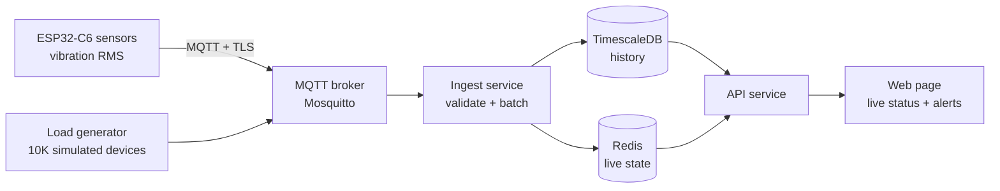

# SpinCycle

**Live laundry machine availability for campus laundry rooms, powered by ESP32-C6 sensors and a general-purpose IoT fleet backend.**

> 🚧 Work in progress: target launch **Nov 8, 2026**. Live demo link coming in week 3.

Never walk down to the laundry room just to find every machine taken. SpinCycle puts a small vibration sensor on each washer and dryer, figures out which machines are free, running or finished, and shows it on a live web page. Tap **"Notify me"** and you'll get an email when your load is done.

Under the hood, SpinCycle is a general IoT fleet platform: devices, device types and fleets are modeled generically, so a laundry room is just the first fleet, not the only one.

---

## Features

- **Live machine status**: free, running or finished, updated every few seconds
- **"Notify me when done"**: email alert when your machine finishes
- **Busy-times chart**: when the laundry room is usually quiet, by hour and day
- **Device management**: per-device credentials, heartbeats and offline alerts
- **Built to scale**: load-tested with 10,000 simulated devices (results below)

## Architecture



1. Each ESP32-C6 samples an accelerometer and publishes a vibration level (RMS) every 5 seconds over MQTT.
2. The ingest service authenticates devices, validates messages and batch-writes them to TimescaleDB.
3. A state machine on the server turns vibration levels into machine states, with a delay so a pause mid-cycle isn't mistaken for "done".
4. The API serves live state (from Redis) and history (from TimescaleDB) to the web page and sends notifications.

## Tech stack

| Layer | Technology |
| --- | --- |
| Firmware | ESP-IDF (C) on ESP32-C6, MPU-6050 / ADXL345 accelerometer |
| Messaging | MQTT (Mosquitto) |
| Backend | _Go or Python (FastAPI) — TBD_ |
| Storage | PostgreSQL + TimescaleDB, Redis |
| Frontend | React |
| Infrastructure | Docker Compose, GitHub Actions |

## Repository structure

```
spincycle/
├── firmware/            # ESP-IDF project for the ESP32-C6
├── services/
│   ├── ingest/          # MQTT → validate → batch write
│   └── api/             # REST API, state machine, notifications
├── dashboard/           # Web page
├── tools/
│   └── loadgen/         # Simulated device fleet for benchmarks
├── deploy/
│   ├── docker-compose.yml
│   └── mosquitto/       # Broker config and ACLs
├── docs/
│   ├── message-format.md
│   └── data-model.md
└── .github/workflows/   # CI
```

## Getting started

**Prerequisites:** Docker and Docker Compose. For firmware: [ESP-IDF](https://docs.espressif.com/projects/esp-idf/) and an ESP32-C6 board.

```bash
git clone https://github.com/<your-username>/spincycle.git
cd spincycle
docker compose -f deploy/docker-compose.yml up
```

_Service ports and firmware flashing steps will be added as each component lands._

## Message format

Devices publish to:

```
fleets/{fleet_id}/devices/{device_id}/telemetry
```

```json
{
  "device_id": "c6-washer-03",
  "seq": 1842,
  "ts": "2026-10-20T14:03:11Z",
  "metrics": { "vibration_rms": 0.42 }
}
```

`seq` increases with every message, so the backend can detect duplicates and gaps. Full spec: [`docs/message-format.md`](docs/message-format.md).

## Benchmarks

_Coming in week 4._

| Simulated devices | Messages/sec | p99 ingest latency | Hardware |
| --- | --- | --- | --- |
| 10,000 | TBD | TBD | TBD |

## Roadmap

- [ ] **Week 1:** First real sensor reading reaches the backend
- [ ] **Week 2:** Machine state detected on a real washer; status page v1
- [ ] **Week 3:** Deployed with HTTPS; devices installed in the laundry room
- [ ] **Week 4:** Email notifications, offline alerts, load test, launch

**Later:** web push notifications, "almost done" estimates, a second fleet on the same backend, offline buffering, OTA firmware updates.

## Privacy

SpinCycle never uses cameras and stores no personal data on devices. Emails entered for "Notify me" are used only for that alert and then deleted.

## Team

- **[Your name](https://github.com/<you>)**: firmware, ingest pipeline, device management
- **[Friend's name](https://github.com/<friend>)**: API, web page, notifications, deployment

## License

MIT
