# SpinCycle

**Live laundry machine availability for campus laundry rooms, powered by ESP32-C6 sensors and a general-purpose IoT fleet backend.**

> 🚧 Work in progress: target launch **Nov 8, 2026**. The backend is deployed at
> **[spincycle.alyfarghali.com](https://spincycle.alyfarghali.com)** (broker on `:8883`); the web page is next.

### Status

| Part | State |
|---|---|
| Firmware | Wi-Fi with backoff, SNTP, accelerometer and RMS on the board; MQTT publishing next |
| Broker | Deployed: TLS on 8883 with a Let's Encrypt certificate, per-device accounts (dynsec) |
| Ingest | Deployed: validation, dedup, TimescaleDB, state engine, Redis live state |
| API | Contract written ([`docs/api.md`](docs/api.md)); skeleton in [`services/api/`](services/api/) |
| Web page | Not started |
| Load generator | 10,000 separate device connections; benchmark results pending |

Never walk down to the laundry room just to find every machine taken. SpinCycle puts a small vibration sensor on each washer and dryer, figures out which machines are free, running or finished, and shows it on a live web page. Tap **"Notify me"** and you'll get an email when your load is done.

Under the hood, SpinCycle is a general IoT fleet platform: devices, device types and fleets are modeled generically, so a laundry room is just the first fleet, not the only one.

---

## Features

- **Live machine status**: free, running or finished, updated every few seconds
- **"Notify me when done"**: email alert when your machine finishes
- **Busy-times chart**: when the laundry room is usually quiet, by hour and day
- **Device management**: per-device credentials, heartbeats and offline alerts
- **Built to scale**: load-tested with 10,000 simulated devices (results below)

## Architecture

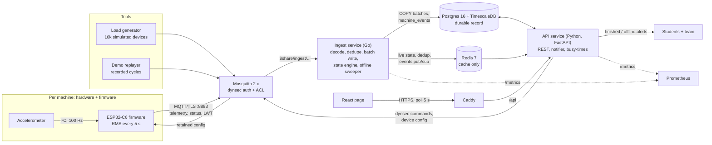

1. Each ESP32-C6 samples an accelerometer at 100 Hz and publishes one vibration RMS value every 5 seconds over MQTT/TLS.
2. Mosquitto authenticates each device and only lets it publish to its own topics in its own fleet.
3. The ingest service validates and dedupes readings, batch-writes them to TimescaleDB, updates live state in Redis, and runs the state engine that turns vibration into free / running / finished / offline.
4. The API serves live state from Redis and history from TimescaleDB to the web page, notifies students when their machine finishes, and alerts the team when a device goes offline.

## Low-level design

Each high-level component is a top-level folder; each low-level piece is a file or subfolder inside it.

### Hardware — [`hardware/`](hardware/) (Twyla)

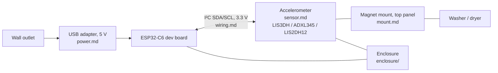

Sensor choice, power source and mount are still open; `bom.md` tracks cost per device and `pcb/` is the stretch custom board.

### Firmware — [`firmware/`](firmware/) (Twyla)

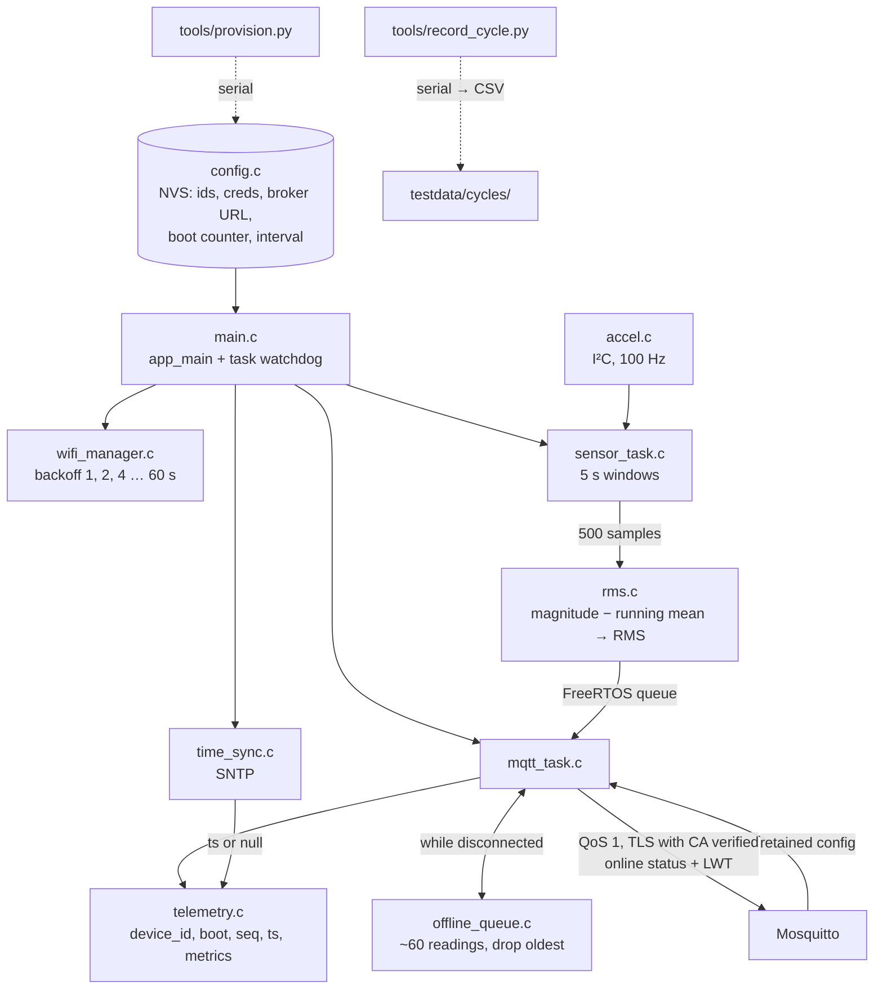

### MQTT broker — [`broker/`](broker/) (Aly)

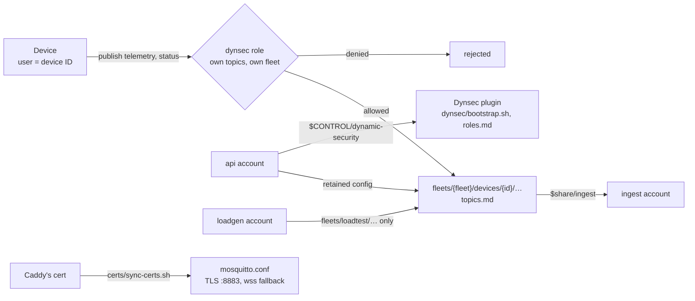

### Ingest service — [`services/ingest/`](services/ingest/) (Aly, Go)

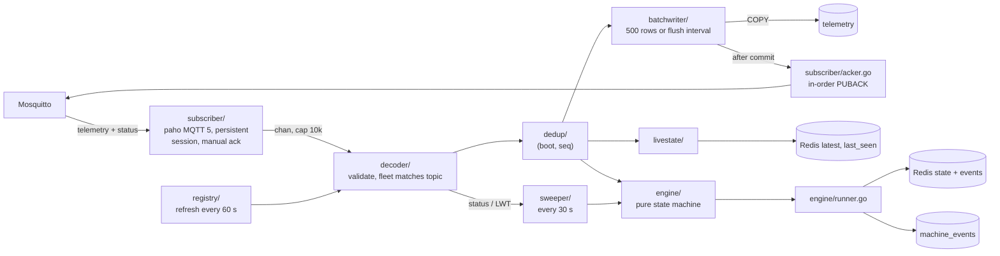

The acker is what makes QoS 1 survive an ingest crash: a message is only acknowledged after the row holding it is committed.

#### State engine — [`services/ingest/engine/`](services/ingest/engine/)

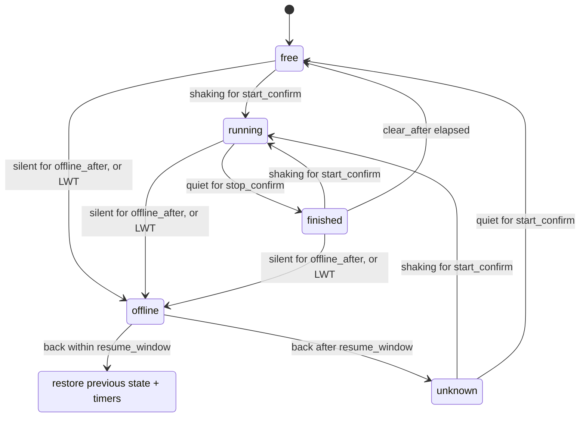

There is deliberately no `offline → free` edge: a sensor that drops off Wi-Fi mid-cycle must never show its machine as free. Thresholds and timers come from `device_types.config` / `devices.config`, and `replay_test.go` runs every recorded cycle in `testdata/cycles/` through the engine.

### Storage — [`storage/`](storage/) (Aly)

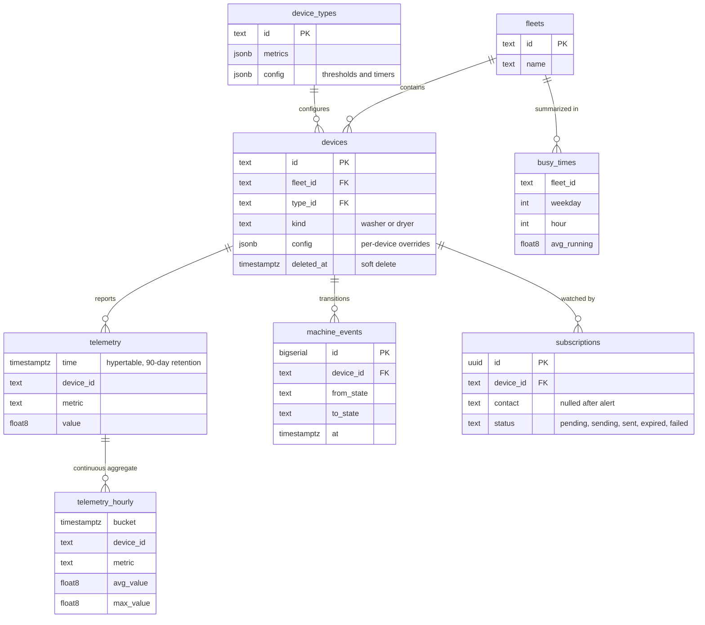

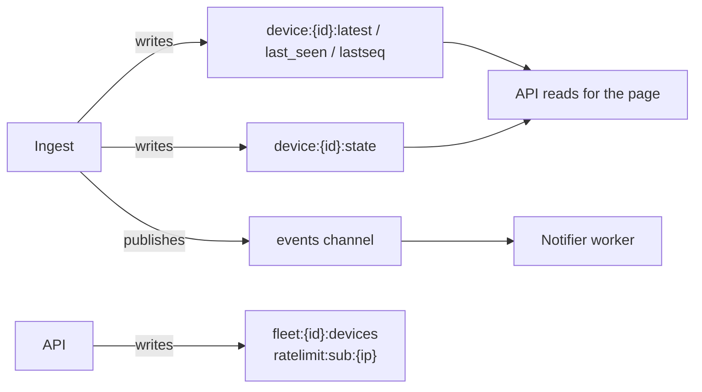

Redis is a cache with persistence off; [`storage/redis/keys.md`](storage/redis/keys.md) documents how each key rebuilds if it is wiped.

### API service — [`services/api/`](services/api/) (Aly, Python)

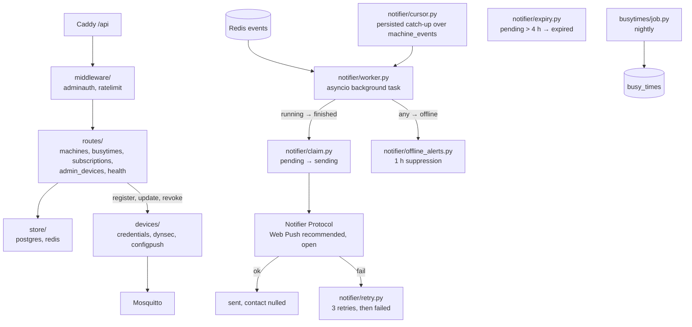

### Web page — [`web/`](web/) (Aly; Twyla writes How it works)

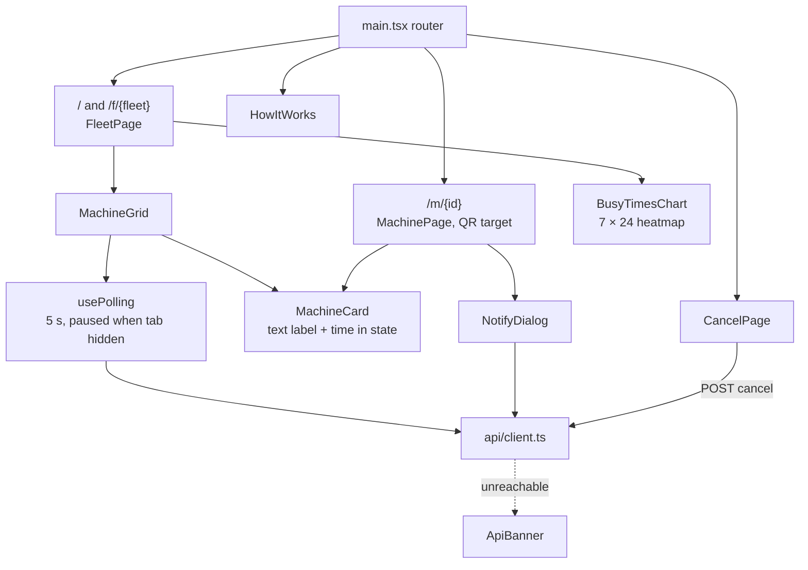

### Load generator and demo — [`tools/`](tools/) (Aly; demo shared)

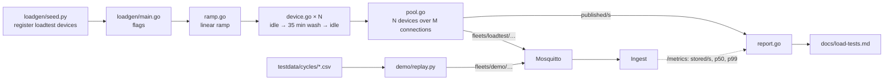

### Deployment, CI and observability — [`deploy/`](deploy/), [`.github/workflows/`](.github/workflows/) (Aly; Twyla owns the firmware build)

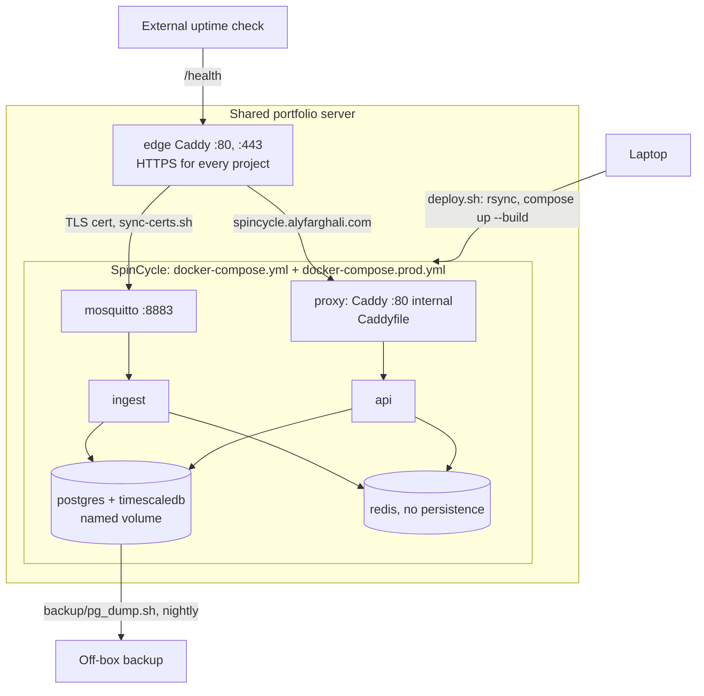

SpinCycle shares a server with other projects; one edge Caddy terminates HTTPS for all of them.
[`deploy/README.md`](deploy/README.md) has the layout and setup.

## Tech stack

| Layer | Technology |
| --- | --- |
| Firmware | ESP-IDF (C) on ESP32-C6, ICM-20948 accelerometer |
| Messaging | MQTT (Mosquitto) |
| Backend | Python (FastAPI) for the API, notifier and tooling; Go for the ingest service and load generator |
| Storage | PostgreSQL + TimescaleDB, Redis |
| Frontend | React |
| Infrastructure | Docker Compose, GitHub Actions |

## Repository structure

One top-level folder per high-level component; every file starts with a one-line comment saying what it is for.

```
spincycle/
├── hardware/            # Sensor, power, mount, wiring, enclosure, BOM, optional PCB
├── firmware/            # ESP-IDF project for the ESP32-C6
│   ├── main/            # accel, sensor_task, rms, mqtt_task, telemetry, offline_queue,
│   │                    # wifi_manager, time_sync, config, secrets.h.example
│   ├── test/            # Host-side tests for pure firmware code
│   └── tools/           # provision.py, record_cycle.py
├── broker/              # mosquitto.conf, topics, dynsec setup and roles, cert sync
├── services/
│   ├── ingest/          # Go: subscriber, decoder, registry, dedup, batchwriter,
│   │                    # livestate, engine, sweeper, metrics
│   └── api/             # Python: routes, middleware, store, devices, notifier, busytimes
├── storage/             # Postgres migrations, seed data, Redis key layout
├── web/                 # React page: pages, components, hooks, API client
├── tools/
│   ├── loadgen/         # Go: simulated device fleet for benchmarks
│   └── demo/            # Replays recorded cycles into the demo fleet
├── testdata/cycles/     # Recorded washer/dryer cycles (shared fixtures)
├── deploy/              # docker-compose.yml, Caddyfile, Prometheus, backups, deploy script
├── docs/                # Telemetry contract, provisioning, load-test results, ADRs
├── .github/workflows/   # CI, deploy, firmware build
├── go.mod               # Single Go module for ingest and loadgen
└── .env.example
```

## Getting started

**Prerequisites:** Docker and Docker Compose. For firmware: [ESP-IDF](https://docs.espressif.com/projects/esp-idf/) and an ESP32-C6 board.

```bash
git clone https://github.com/alyfarghali/spincycle.git
cd spincycle
cp .env.example .env
broker/certs/make-dev-certs.sh
docker compose --env-file .env -f deploy/docker-compose.yml up -d postgres redis mosquitto
broker/dynsec/bootstrap.sh
docker compose --env-file .env -f deploy/docker-compose.yml up -d --build ingest
```

Set every `change-me` in `.env` first. Each component's README covers the rest:
[`firmware/`](firmware/README.md), [`services/ingest/`](services/ingest/README.md),
[`services/api/`](services/api/README.md), [`storage/`](storage/README.md),
[`tools/loadgen/`](tools/loadgen/README.md), [`deploy/`](deploy/README.md).

## Message format

Devices publish to:

```
fleets/{fleet_id}/devices/{device_id}/telemetry
```

```json
{
  "v": 1,
  "device_id": "c6-washer-03",
  "fw": "0.1.0",
  "boot": 12,
  "seq": 1842,
  "ts": "2026-10-20T14:03:11.250Z",
  "metrics": { "vibration_rms": 0.0423 }
}
```

`boot` increments on every restart and `seq` on every message, so `(device_id, boot, seq)` identifies a
reading: the backend stores each one once even when MQTT delivers it twice or out of order. Full spec: [`docs/telemetry-contract.md`](docs/telemetry-contract.md).

## Benchmarks

_Coming in week 4._

| Simulated devices | Messages/sec | p99 ingest latency | Hardware |
| --- | --- | --- | --- |
| 10,000 | TBD | TBD | TBD |

## Roadmap

- [ ] **Week 1:** First real sensor reading reaches the backend
- [ ] **Week 2:** Machine state detected on a real washer; status page v1
- [ ] **Week 3:** Deployed with HTTPS; devices installed in the laundry room
- [ ] **Week 4:** Email notifications, offline alerts, load test, launch

**Later:** web push notifications, "almost done" estimates, a second fleet on the same backend, offline buffering, OTA firmware updates.

## Privacy

SpinCycle never uses cameras and stores no personal data on devices. Emails entered for "Notify me" are used only for that alert and then deleted.

## Team

- **[Your name](https://github.com/<you>)**: firmware, ingest pipeline, device management
- **[Friend's name](https://github.com/<friend>)**: API, web page, notifications, deployment

## License

MIT
