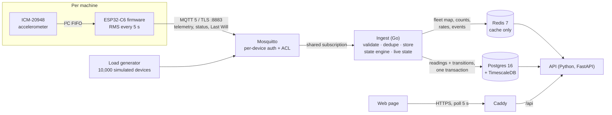
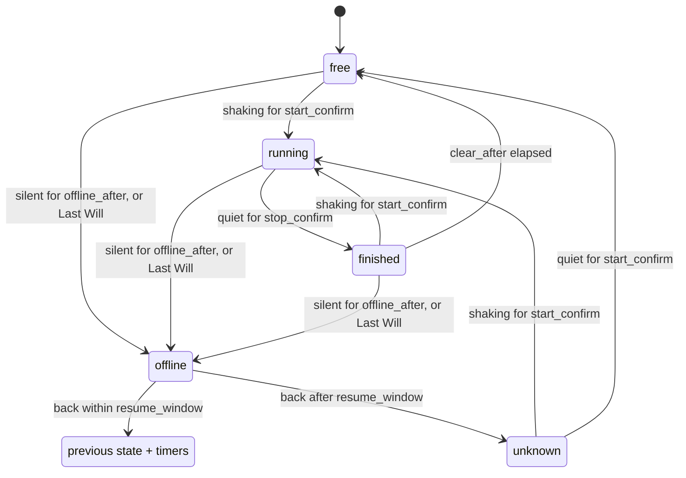

# SpinCycle

**Live laundry-machine status from clip-on vibration sensors, built on an IoT fleet backend designed for
10,000 devices.**

[spincycle.alyfarghali.com](https://spincycle.alyfarghali.com) · [Telemetry contract](docs/telemetry-contract.md) · [API contract](docs/api.md) · [Load tests](docs/load-tests.md)

An ESP32-C6 with an accelerometer clips onto each washer and dryer. Every 5 seconds it publishes one
number, the vibration RMS, over MQTT/TLS. The backend turns that stream into **free / running / finished
/ offline** for every machine and shows it on a live web page. Students stop walking down to a full
laundry room.

The laundry room is the first fleet, not a special case. Devices, device types and fleets are modelled
generically, so a new kind of sensor is a database row, not a code change. The real deployment has a
handful of devices. The backend is built and load-tested for 10,000.

---

## Engineering highlights

- **No lost readings, no duplicates, across crashes.** Ingest acknowledges an MQTT message only after the
  reading is committed to Postgres, using a persistent MQTT 5 session. The dedup record
  `(device_id, boot, seq)` is written in the same transaction as the reading. Measured: 3,000 of 3,000
  readings stored exactly once with ingest `kill -9`'d mid-stream ([run 0](docs/load-tests.md)).
- **A state machine that never shows a wrong "free".** Classification is a pure function
  `(state, reading, now, params) → (state, transitions)`. It uses hysteresis (separate on/off thresholds)
  and confirmation windows that ride out wash-cycle pauses. A sensor that drops off Wi-Fi mid-cycle comes
  back to its previous state, or to `unknown`. It never jumps to `free`, which would skip the "finished"
  alert. Table-driven tests replay recorded cycles through it.
- **Live state for 10,000 devices in one Redis read.** Ingest keeps a per-fleet state map and per-state
  counts. A Lua script updates both atomically, so the counts can't drift from the map whatever order
  updates arrive in. A Redis outage never blocks storage: ingest backs off and rebuilds the cache from
  Postgres.
- **An API sized for the whole fleet on screen.** The entire fleet's live state is one string, one
  character per device (~10 KB for 10,000 devices, versus ~1.1 MB of JSON). Responses are cached for 2 s
  behind a single-flight lock, so a thousand viewers cost one Redis read every 2 s.
- **Security end to end.** TLS on every hop. The broker serves a real Let's Encrypt certificate, which
  devices verify with ESP-IDF's certificate bundle; there is no skip-verification option anywhere. Each
  device has its own credential and can publish only to its own topics, enforced by Mosquitto's
  dynamic-security plugin.
- **A load generator that tests connections, not just message rate.** Each simulated device holds its own
  MQTT connection, with its own Last Will and online/offline status. 10,000 devices means 10,000 real
  connections.

## Architecture



**One reading, end to end:**
1. The device samples the accelerometer, computes the RMS of the magnitude minus its mean over a 5 s
   window, and publishes `{v, device_id, fw, boot, seq, ts, metrics}` at QoS 1.
2. Mosquitto checks the device's credential and that the topic is its own, then delivers to ingest
   through a shared subscription, so more ingest replicas can be added without code changes.
3. Ingest validates the payload against the device registry (the topic, not the payload, decides which
   device and fleet a reading belongs to). It stores the reading and its dedup record in one transaction,
   runs the state engine, and writes any transition in that same transaction. Only then does it
   acknowledge the message.
4. Ingest updates Redis: the latest reading, the fleet's state map and counts, per-second rates, and a
   pub/sub event per transition.
5. The page polls the API, which serves live state from Redis and history from TimescaleDB.

### Machine state engine



There is deliberately no `offline → free` edge. Thresholds and timers live in `device_types.config`, with
per-device overrides, so retuning means a migration and no reflash. Readings that arrive late (MQTT
doesn't guarantee order) are stored but never move the state backwards.

## Design decisions

| Decision | Chosen | Over | Why |
|---|---|---|---|
| Device protocol | MQTT over TLS | HTTPS POST per reading | Persistent connection, tiny per-message overhead, Last Will for offline detection |
| Where state is decided | Server | Device | Retune without reflashing; one implementation to test |
| What the device sends | One RMS value every 5 s | Raw samples | 1 number instead of ~500 per window, and enough to detect a running machine |
| Delivery guarantee | At least once + dedup on `(device_id, boot, seq)` | Exactly once, or `seq > last` | Set membership survives reboots, reordering and multiple ingest replicas; `seq > last` drops valid late readings |
| When to acknowledge | After the database commit | On receipt | Acking on receipt loses everything buffered when ingest crashes |
| Time-series storage | TimescaleDB | InfluxDB, plain Postgres | Still Postgres (SQL, joins, transactions), plus hypertables, retention and continuous aggregates |
| Telemetry schema | Narrow rows `(time, device, metric, value)` | A column per metric | New device types need no migration |
| Live state | Redis, maintained by ingest | Querying Postgres per page load | The page reads a few keys, not 10,000 rows |
| Ingest scaling | MQTT shared subscriptions | Kafka | Mosquitto supports MQTT 5 shared subscriptions; Kafka is overkill at 2,000 msg/s |
| Device auth | Mosquitto dynamic-security plugin | Rewriting a password file and reloading | Credentials managed over MQTT, no config-file writes or container signalling |
| Page updates | Poll every 5 s with a 2 s cache | WebSockets / SSE | Simplest, cacheable, and load is independent of viewer count |
| Languages | Go for ingest and the load generator, Python for the API | One language | Ingest needs bounded concurrency and in-order manual acks; the API is I/O-bound glue |
| Deployment | Docker Compose on one VM | Kubernetes | One machine handles the load; Compose is the same file locally and in production |

## Status

| Component | State |
|---|---|
| Firmware | Wi-Fi with jittered exponential backoff, SNTP, ICM-20948 FIFO driver, RMS windows; MQTT publishing in progress |
| Broker | Deployed: TLS with a Let's Encrypt certificate, per-device accounts and ACLs |
| Ingest | Deployed: validation, crash-safe dedup, state engine, Redis live state |
| Storage | TimescaleDB hypertable, dedup set, machine events, engine parameters |
| Load generator | 10,000 separate device connections with Last Will and status |
| API | Contract written; implementation in progress |
| Web page | Planned: canvas fleet map for large fleets, card grid for the laundry room |
| Planned next | Batched writes, "notify me when done" (Web Push), offline alerts, busy-times heatmap, benchmarks |

## Tech stack

| Layer | Technology |
|---|---|
| Hardware | ESP32-C6, ICM-20948 IMU over I²C |
| Firmware | C, ESP-IDF, FreeRTOS |
| Messaging | MQTT 5, Mosquitto 2 with dynamic security |
| Ingest | Go, `paho.golang`, `pgx`, `go-redis` |
| API | Python, FastAPI, asyncpg, redis-py |
| Storage | PostgreSQL 16 + TimescaleDB, Redis 7 |
| Infrastructure | Docker Compose, Caddy (automatic HTTPS) |

## Repository layout

```
firmware/            ESP-IDF project: sensing (accelerometer, RMS), connectivity (Wi-Fi, SNTP, telemetry),
                     host tests and an on-board Unity test app
broker/              mosquitto.conf, dynamic-security bootstrap and device scripts, certificate sync
services/ingest/     Go: subscriber, decoder, registry, dedup store, state engine, live state, metrics
services/api/        Python: FastAPI routes, Postgres and Redis stores, cache
storage/             SQL migrations, Redis key layout
tools/loadgen/       Go load generator and device seed data
testdata/            Washer and dryer cycles for replay tests
deploy/              Docker Compose, Caddy, deploy script
docs/                Telemetry contract, API contract, load-test log, ADRs
```

Each folder has its own README with the details.

## Running locally

Requires Docker. For firmware, [ESP-IDF](https://docs.espressif.com/projects/esp-idf/) and an ESP32-C6.

```bash
git clone https://github.com/alyfarghali/spincycle.git
cd spincycle
cp .env.example .env
broker/certs/make-dev-certs.sh
docker compose --env-file .env -f deploy/docker-compose.yml up -d postgres redis mosquitto
broker/dynsec/bootstrap.sh
docker compose --env-file .env -f deploy/docker-compose.yml up -d --build ingest
```

Set every `change-me` in `.env` first. Then simulate devices with [`tools/loadgen`](tools/loadgen/README.md),
or flash a board with [`firmware`](firmware/README.md).

## Tests

```bash
eval "$(storage/test-db.sh | tail -1)"
TEST_REDIS_URL=redis://localhost:6379/15 go test ./...
firmware/test/run.sh
```

The Go tests cover the decoder against every validation rule in the contract, dedup and crash safety
against a real Postgres, the state engine with table-driven and replay tests, Redis live state, and the
load generator's payloads (checked with ingest's own decoder). Firmware host tests cover RMS, the
telemetry payload and backoff.

## Message format

Devices publish to `fleets/{fleet_id}/devices/{device_id}/telemetry`:

```json
{
  "v": 1,
  "device_id": "c6-washer-03",
  "fw": "0.1.0",
  "boot": 12,
  "seq": 1842,
  "ts": "2026-10-20T14:03:11.250Z",
  "metrics": { "vibration_rms": 0.0423 }
}
```

`boot` increments on every restart and `seq` on every message, so `(device_id, boot, seq)` identifies a
reading even when MQTT delivers it twice or out of order. Full specification:
[`docs/telemetry-contract.md`](docs/telemetry-contract.md).

## Privacy

No cameras and no personal data on devices: a sensor reports only how much a machine is shaking.
